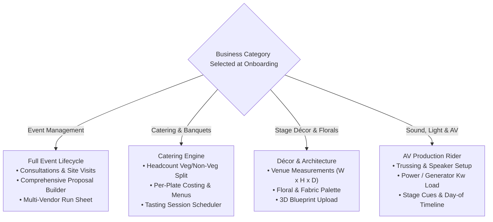
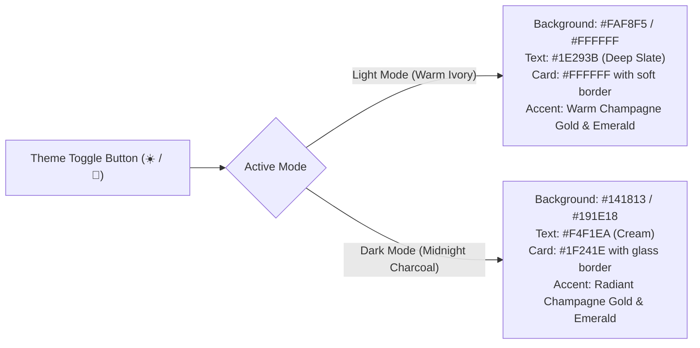

# Occasion Desk: Multi-Industry B2B SaaS Architecture & Master Plan
*The Operating System for Event Management, Catering Firms, Stage Décor Studios & Production Crews*

---

## 1. Executive Vision & Multi-Industry Scope

### Universal Operating System for Event Businesses
**Occasion Desk** is designed to serve any business that executes events:
1. **Event Planners & Wedding Agencies:** Managing full client journeys from inquiry to final wedding day choreography.
2. **Catering & Banquet Companies:** Managing fluctuating headcounts (Veg vs. Non-Veg), per-plate costing, menu tastings, and kitchen run sheets.
3. **Stage Décor & Floral Architecture Teams:** Managing venue dimensions, floral recipes, mandap/backdrop designs, and site visits.
4. **Sound, Lighting & AV Production Crews:** Managing equipment trussing, generator/power loads, light cues, and technical riders.

### Key Architectural Upgrades
* **Light Theme & Dark Theme Support:** Luxury Warm Ivory (Light) and Midnight Charcoal (Dark) with champagne gold and emerald accents, persisted across sessions.
* **Unified Full-Stack Architecture (Clean Service Layer):** Next.js 15 App Router Route Handlers organized into dedicated backend service modules (`organization.service`, `booking.service`, `partner.service`, `catering.service`, `payment.service`), optimizing RAM efficiency on Oracle Always Free VM while maintaining enterprise code separation.
* **Plain Explanatory Landing Page (`/`):** Plainly explaining how Occasion Desk eliminates chaos for each industry type with interactive live previews.
* **Provisions for:**
  - Self-serve business onboarding (`/onboard`).
  - Partner & vendor enrollment with role-based visibility (`/desk/team`).
  - Manual booking entry for walk-ins, phone inquiries, and WhatsApp referrals (`+ Add Booking`).
  - Comprehensive booking lifecycle management across Kanban, Calendar, and Ledger.

---

## 2. Multi-Industry Feature Matrix



| Industry Focus | Specialized Data Fields & Features |
| :--- | :--- |
| **Event Planning** | Full 6-stage Kanban, client consultation notes, budget range, end-to-end milestone ledger. |
| **Catering & Food** | Guest Headcount (Veg vs. Non-Veg), per-plate pricing, menu builder (Appetizers, Mains, Desserts, Live Counters), food tasting logs. |
| **Stage Décor** | Venue dimensions, ceiling height, stage width, flower freshness logistics, backdrop palette swatches, setup access window. |
| **Sound & Light** | Trussing dimensions, sound console specs, moving heads count, generator backup requirements, sound check schedule. |

---

## 3. Light & Dark Theme System

A luxury design system supporting instant toggling without layout shift:



* **Tailwind Class Strategy:** Root `<html class="dark">` or `<html class="light">` with CSS variable mappings.
* **Zero Flicker:** Theme preference checked in `layout.tsx` before DOM paint, persisted in `localStorage`.
* **Accessible Contrast:** High-contrast buttons guaranteed in both light and dark themes.

---

## 4. Backend Service Architecture (Clean Layered Pattern)

Instead of bloated monolithic route handlers, all business logic is organized into clean, reusable service layers:

```
src/
├── app/
│   ├── api/
│   │   ├── auth/                # Login, Logout, Change Password
│   │   ├── onboard/             # Self-serve business provisioning
│   │   ├── desk/
│   │   │   ├── leads/           # Manual & Inbound booking endpoints
│   │   │   ├── team/            # Partner enrollment & assignments
│   │   │   ├── catering/        # Headcounts, plate pricing & menus
│   │   │   ├── visits/          # Venue visits & tasting sessions
│   │   │   ├── proposals/       # Itemized quote generator
│   │   │   └── payments/        # Advance & milestone ledger
│   ├── (public)/
│   │   ├── page.tsx             # Explanatory SaaS Landing Page
│   │   ├── onboard/page.tsx     # Business Onboarding Wizard
│   │   ├── login/page.tsx       # Unified Partner & Admin Login
│   │   └── i/[slug]/page.tsx    # Branded Client Intake Link
│   └── desk/
│       └── page.tsx             # Multi-Industry Workspace (Kanban, Team, Catering, Ledger)
├── services/
│   ├── organization.service.ts  # Tenant isolation & settings
│   ├── booking.service.ts       # Lead/Booking CRUD & stage progression
│   ├── partner.service.ts       # Partner roles, credentials & scoping
│   ├── catering.service.ts      # Headcounts & menu calculations
│   └── payment.service.ts       # Financial ledger & receipt generation
├── lib/
│   ├── auth.ts                  # JWT token verification & session extraction
│   └── prisma.ts                # Prisma client singleton
```

---

## 5. The 4 Core Feature Workflows

### 1. Explanatory Homepage (`/`)
* **Hero:** Explains Occasion Desk in plain, transparent language:
  > *"The Operating System for Event Planners, Caterers, and Stage Décor Studios."*
  > *"Stop losing bookings in WhatsApp. From manual walk-in entry to catering headcounts, partner coordination, and advance payments—manage your entire event business in one command center."*
* **Target Audience Tabs:** Interactive tabs allowing an Event Planner, a Caterer, and a Décor Studio to see how Occasion Desk directly applies to their daily workflow.
* **Theme Switcher:** Visitors can toggle Light/Dark mode directly from the navbar.
* **Direct Actions:**
  * `[ Onboard Your Business → ]` (routes to `/onboard`)
  * `[ Partner Sign In ]` (routes to `/login`)

### 2. Business Onboarding (`/onboard`)
* **Company Information:**
  * Business Name (e.g., *"Grand Feast Caterers"*, *"Royal Stage Architecture"*, *"Heavenly Events"*).
  * Business Category (`Event Management`, `Catering & Banquets`, `Stage Décor`, `AV & Production`).
  * Operating Region (e.g. Kollam, Punalur, Kochi, Trivandrum, etc.).
  * Contact Phone & WhatsApp Number.
* **Owner Account:** Name, Email, Password.
* **Instant Provisioning:** Instantly creates tenant workspace with sample bookings tailored to the chosen business category.

### 3. Partner Enrollment Hub (`/desk` -> Team)
* **Enroll Collaborators:** Firm owner can add in-house staff and external contractor partners:
  * **`PLANNER / COORDINATOR`**: Full event scheduling, quotes, and client messaging.
  * **`CATERING_PARTNER`**: Can view guest headcounts, Veg/Non-Veg split, menu items, and dining schedules.
  * **`DECOR_PARTNER`**: Can view stage blueprints, venue measurements, and floral mandates.
  * **`SOUND_LIGHT_PARTNER`**: Can view trussing specs, power load, and audio cues.
  * **`ACCOUNTS`**: Access to advances, milestone settlements, and receipts.
* **Role Privacy:** Field vendors cannot see overall client contract totals or other vendors' margins.

### 4. Manual Booking Creation (`+ Add Booking`)
A dedicated modal accessible anywhere inside `/desk`:
* **Client Details:** Client Name, Mobile Phone, WhatsApp toggle.
* **Event Metadata:** Occasion Type (Wedding, Reception, Catering Order, Ring Ceremony, Corporate Event), Target Date, Venue Name, City.
* **Scope & Catering:** Expected Guest Count, Veg/Non-Veg Headcount Split, Dining Style (Sadhya, Buffet, Cocktail), Estimated Budget (₹).
* **Initial Status:** Can be added directly as `NEW`, `IN_CONSULTATION`, or `CONFIRMED (BOOKED)` if client already booked off-platform.
* **Assigned Partner:** Dropdown selecting from enrolled partners.

---

## 6. Execution Roadmap & Next Steps

1. **Sprint 1: Explanatory SaaS Landing Page & Light/Dark Theme**
   - Rebuild `src/app/page.tsx` as the SaaS marketing page with industry tabs (Events, Catering, Décor).
   - Implement persistent Light/Dark theme toggle.
   - Remove legacy single-agency portfolio routes (`/weddings`, `/receptions`, `/mini-events`).
2. **Sprint 2: Manual Booking Entry & Enhanced Business Onboarding**
   - Add `+ Add Booking` modal in `src/components/DeskDashboard.tsx`.
   - Wire `POST /api/desk/leads` endpoint with industry-specific fields (Veg/Non-Veg headcount, dining style, venue measurements).
   - Upgrade `/onboard` with business category selection.
3. **Sprint 3: Partner Enrollment & Role Scoping**
   - Build "Team & Partners" tab in `/desk`.
   - Wire `POST /api/desk/team` for instant partner onboarding.
   - Add partner assignment dropdown to all booking cards.
4. **Sprint 4: Verification & Cloud Deployment**
   - Test full multi-tenant flow on `http://localhost:3001`.
   - Continuous deployment to Oracle Cloud server `http://144.24.139.226`.
